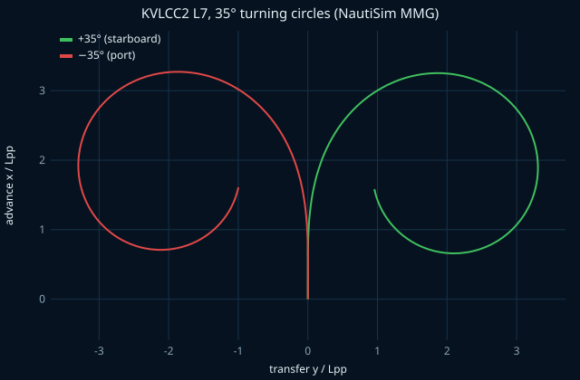
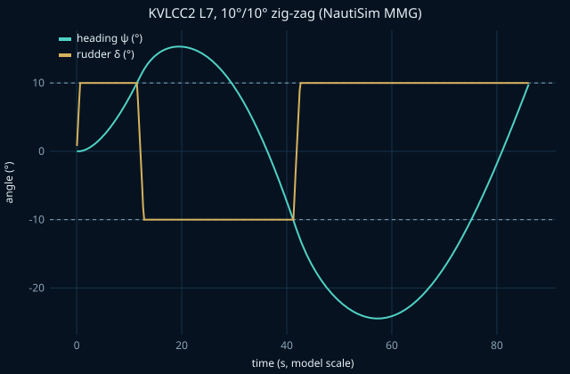
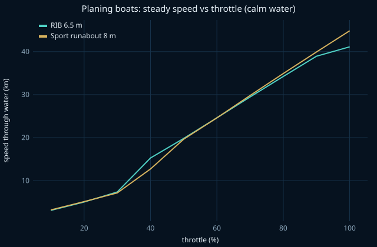

# NautiSim

**A physics-first marine bridge simulator for iOS and Android.** Pick a boat, hold your phone like a steering wheel and drive: tilt to steer, push the lever (or tilt the top edge away) for throttle. Underneath is a deterministic 6-degree-of-freedom ship-physics engine validated against published towing-tank and free-running benchmarks.

[](https://github.com/coletebou/NautiSim/actions/workflows/ci.yml)

| KVLCC2 turning circles                          | 10°/10° zig-zag                        | Planing boats                               |
| ----------------------------------------------- | -------------------------------------- | ------------------------------------------- |
|  |  |  |

_These plots are produced by the simulator itself (`pnpm validation-report`); see [docs/validation.md](docs/validation.md) for the numbers against the published references._

## What's in it

- **Three vessels**
  - **KVLCC2 tanker (320 m).** Manoeuvring uses the MMG standard method (the Japanese "Maneuvering Modeling Group" model that splits the forces into hull, propeller and rudder parts) with the published KVLCC2 coefficients. It takes kilometres to stop and minutes to turn, as it should.
  - **6.5 m RIB** (rigid-inflatable boat) with a 150 hp outboard.
  - **8 m sport runabout** with a 300 hp sterndrive. Both small boats plane using Savitsky's equations (the standard empirical model of how a fast V-bottom hull lifts out of the water), run in the time domain so trim and speed emerge from the dynamics.
- **Real buoyancy on real waves.** Every hull floats on its actual triangle mesh: each triangle is clipped against the water surface and the water pressure is integrated over the wet part. The ocean you see is sampled from exactly the same wave function, so the boat sits on the waves on screen.
- **Seas, wind and current.** Irregular seas from a JONSWAP spectrum (the standard recipe for wind-driven waves) with directional spreading, gusting wind, tidal current, all seeded so a run can be replayed exactly.
- **Motion helm.** Gravity-based tilt steering that works the same on iOS and Android, a one-tap "set centre" calibration, dead zone, sensitivity and expo curve, rate limiting, a 1€ filter (a smoothing filter that is calm when you hold still and quick when you move), plus an on-screen wheel and throttle lever as an accessible fallback.
- **Bridge HUD.** Speed over ground and through the water, heading, course, engine rpm, rudder angle, heel and trim, wind, and a mini chart with your track. Chase, bridge and orbit cameras. Haptics at hard-over, the stop detent and wave slams.

## Quickstart

Requirements: Node 22.13 or newer and pnpm (via `corepack enable`).

```sh
git clone https://github.com/coletebou/NautiSim.git
cd NautiSim
pnpm install
pnpm test                 # physics, environment and controls tests (incl. validation)
cd apps/mobile
npx expo start
```

- **3D view:** needs a development build, because the WebGPU renderer is a native module: `npx expo run:ios` / `npx expo run:android` on a machine with Xcode or Android Studio, or `eas build --profile development`.
- **Expo Go:** works without a build, but shows a 2-D chart instead of the 3D view (physics, tilt steering, HUD and haptics all run).

Useful scripts from the repo root: `pnpm typecheck`, `pnpm lint`, `pnpm format`, `pnpm test`, `pnpm validation-report`.

## How it is built

```
apps/mobile            Expo app (expo-router): screens, HUD, input wiring, three.js scene on WebGPU
packages/physics       6-DOF rigid body, hydrostatics, MMG, Savitsky, propulsion, hull data, validation
packages/environment   seeded waves (JONSWAP + spreading), wind gusts, current, depth
packages/controls      tilt extraction, calibration, filters, touch wheel and gamepad mapping
```

- The three packages are plain TypeScript with no React Native or browser dependencies, so they run identically in tests, in the app and in a future server or worker.
- Physics runs at a fixed step (1/60 s for the small boats, 1/30 s for the tanker) from an accumulator, with interpolated rendering. It runs on React Native's JS thread, which is separate from the phone's UI thread, and React never re-renders per frame.
- Rendering is three.js with its WebGPU renderer on `react-native-webgpu` (Metal on iOS, Vulkan on Android).

The design decisions, with the alternatives considered, are in [docs/architecture.md](docs/architecture.md); the research behind them, with sources, is in [docs/research.md](docs/research.md).

## Validation at a glance

| Check                                                  | Result                                                                       |
| ------------------------------------------------------ | ---------------------------------------------------------------------------- |
| KVLCC2 35° turning circle (advance, tactical diameter) | within 5 % of Yasukawa & Yoshimura's MMG and 8 % of MARIN free-running tests |
| KVLCC2 10/10 and 20/20 zig-zag overshoots              | within 2.5° (1st) / 3.5° (2nd) of the MMG reference                          |
| Savitsky lift and drag                                 | matches a published worked example to 0.1 %                                  |
| Hydrostatics                                           | box-barge volume, KB, BM, GM and the wall-sided GZ formula to 6 decimals     |
| JONSWAP spectra and wave field                         | Hs recovered from the spectrum and from the generated surface                |
| Determinism                                            | two runs with the same inputs are bit-identical                              |

## Status: what is verified and what is not

Verified here (Linux CI, no phone): unit and validation tests, strict typechecks, lint, `expo-doctor`, and JavaScript bundles exported for iOS and Android.

Not verified without a device: how tilt steering _feels_, sensor axis conventions on specific phones, frame rate and physics cost on real hardware, and the WebGPU renderer on device. The [roadmap](ROADMAP.md) lists the on-device checklist.

## Prior art and credits

NautiSim follows **boatsim (whiskey.vodka)**, a browser-based bridge simulator by the same author, whose source served as a reference for which models are worth running in real time. NautiSim is a new codebase with a different architecture.

Models and methods: Yasukawa & Yoshimura (2015) MMG standard method; Savitsky (1964) planing; Fossen's _Handbook of Marine Craft Hydrodynamics and Motion Control_; Kerner's _Water interaction model for boats in video games_; DNV-RP-C205 wave spectra; Casiez et al. (2012) 1€ filter; Madgwick (2010) orientation filter.

## License

[MIT](LICENSE).
