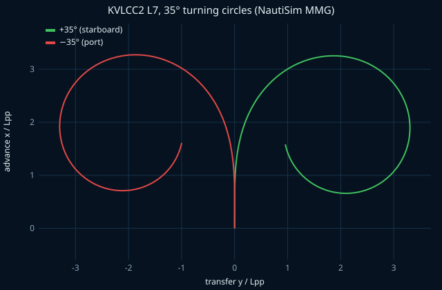
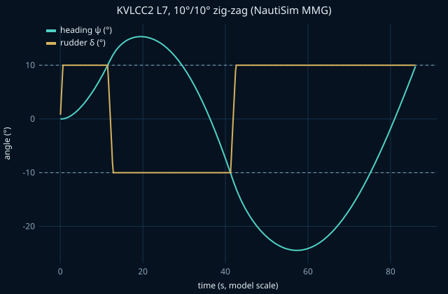
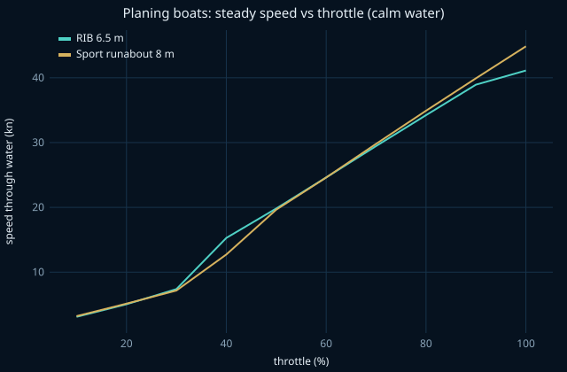

# Validation report

Generated by `pnpm validation-report` from the same simulations the test suite checks (`packages/physics/test`). Sources for the reference numbers are in `packages/physics/src/validation/references.ts` and [research.md](research.md).

## KVLCC2 manoeuvring (MMG, L7 model, Fn 0.142)

Propeller held at the model self-propulsion point, 9.98 rps; rudder rate 15.8 °/s; fixed step 0.05 s, RK4, heave/roll/pitch locked (a 6-DOF run gives the same turning circle within 2 %).

| Manoeuvre       | Quantity                | NautiSim | Yasukawa & Yoshimura MMG | MARIN free-running |
| --------------- | ----------------------- | -------- | ------------------------ | ------------------ |
| +35° turn       | advance / Lpp           | 3.19     | 3.31                     | 3.25               |
| +35° turn       | tactical diameter / Lpp | 3.25     | 3.36                     | 3.34               |
| −35° turn       | advance / Lpp           | 3.21     | 3.26                     | 3.11               |
| −35° turn       | tactical diameter / Lpp | 3.24     | 3.26                     | 3.08               |
| 10/10 zig-zag   | 1st overshoot (°)       | 5.3      | 5.2                      | 8.2                |
| 10/10 zig-zag   | 2nd overshoot (°)       | 14.5     | 15.8                     | 21.9               |
| -10/-10 zig-zag | 1st overshoot (°)       | 7.9      | 7.6                      | 9.5                |
| -10/-10 zig-zag | 2nd overshoot (°)       | 9.0      | 10.2                     | 15                 |
| 20/20 zig-zag   | 1st overshoot (°)       | 10.7     | 10.9                     | 13.7               |
| 20/20 zig-zag   | 2nd overshoot (°)       | 15.3     | 16.8                     | 14.8               |
| -20/-20 zig-zag | 1st overshoot (°)       | 14.5     | 14.5                     | 15.1               |
| -20/-20 zig-zag | 2nd overshoot (°)       | 11.1     | 12.4                     | 13.2               |

Like Yasukawa & Yoshimura's own computation, the overshoot angles come out smaller than the free-running tests; the paper attributes this to the hull damping from the captive tests.

## Planing boats (Savitsky, time domain)

Steady state after 60 s at each throttle setting in calm water.

### RIB 6.5 m

| Throttle | Speed (kn) | Trim (°) | Engine rpm | Dynamic lift / weight |
| -------- | ---------- | -------- | ---------- | --------------------- |
| 10 %     | 3.1        | -0.1     | 550        | 0.00                  |
| 20 %     | 5.0        | 0.6      | 1100       | 0.00                  |
| 30 %     | 7.4        | 1.8      | 1650       | 0.00                  |
| 40 %     | 15.3       | 3.8      | 2200       | 0.20                  |
| 50 %     | 19.8       | 3.7      | 2750       | 0.33                  |
| 60 %     | 24.6       | 3.3      | 3300       | 0.42                  |
| 70 %     | 29.5       | 2.8      | 3850       | 0.48                  |
| 80 %     | 34.2       | 2.5      | 4400       | 0.52                  |
| 90 %     | 38.9       | 2.2      | 4950       | 0.55                  |
| 100 %    | 41.1       | 2.1      | 5209       | 0.56                  |

### Sport runabout 8 m

| Throttle | Speed (kn) | Trim (°) | Engine rpm | Dynamic lift / weight |
| -------- | ---------- | -------- | ---------- | --------------------- |
| 10 %     | 3.2        | 0.1      | 500        | 0.00                  |
| 20 %     | 5.1        | 0.6      | 1000       | 0.00                  |
| 30 %     | 7.2        | 1.6      | 1500       | 0.00                  |
| 40 %     | 12.7       | 3.7      | 2000       | 0.09                  |
| 50 %     | 19.6       | 3.9      | 2500       | 0.28                  |
| 60 %     | 24.6       | 3.6      | 3000       | 0.39                  |
| 70 %     | 29.8       | 3.2      | 3500       | 0.46                  |
| 80 %     | 34.9       | 2.8      | 4000       | 0.51                  |
| 90 %     | 39.9       | 2.4      | 4500       | 0.54                  |
| 100 %    | 44.9       | 2.1      | 5000       | 0.56                  |

The static Savitsky equations themselves are checked against a published worked example in `test/savitsky.test.ts`; hydrostatics against closed-form box-barge values in `test/hydrostatics.test.ts`.
